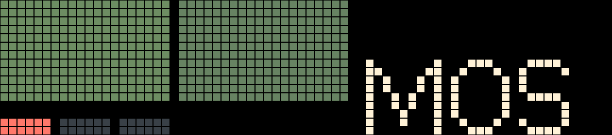
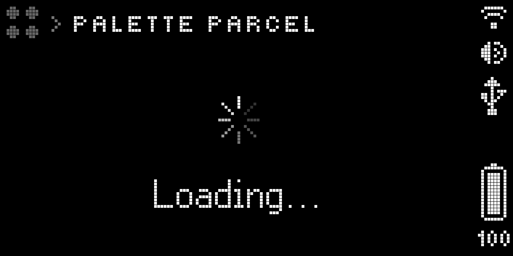
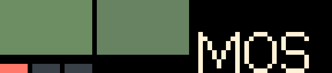

# Palette Parcel

Match an editable RGB swatch to the closest thread in a personal palette using CIE76 colour distance.

Compare a reference swatch only with threads you actually own. The two front-panel patches show the reference and the closest match side by side, with the thread code alongside them.

## Screen transitions

Click through red, green and blue. A short underline opens beneath the selected channel while the swatches keep their actual colours.



<details>

<summary>Watch the rear display</summary>



</details>

## Tune a reference color

1. Enter thread codes and six-digit RGB values in device settings. For example, `MOS|678362,INK|303B47` defines two threads.
2. Turn the wheel to change the active channel by five. The three short marks under the left swatch are red, green and blue in order. The lit mark tells you which channel the wheel edits. Click to select the next one.
3. Compare the two swatches. The right swatch and the code beside it identify the closest thread in your list.



## Compare and save the choice

1. Read the rear for the reference hex value, match hex value and CIE76 distance. A smaller distance means a closer match among these entries.
2. Press **Start** to save the reference RGB. Try another channel adjustment, then hold the wheel to recall the stored reference.
3. Take the suggested physical thread to your fabric for the final comparison. The LEDs display the configured colors.


## Example from the emulator

The sample palette has six entries. The code changes only when another thread becomes a closer match. If the reference exactly equals a palette entry, its calculated color distance is zero.

## Run in the emulator

Open BUSY Bar Emulator. From this repository, run:

```sh
~/.busy-emulator/bin/busy-emulator dev --once
```

Press **Back** to exit.

The GIFs are excerpts from the emulator recording. Each LED occupies a 16 × 16 cell with a black border. The end frames pause for reading.

[Full recording](media/controls.mp4) · [Rear display](screenshots/back-1.png) · [Firmware test](EMULATOR-QA.md) · [MIT license](LICENSE)
